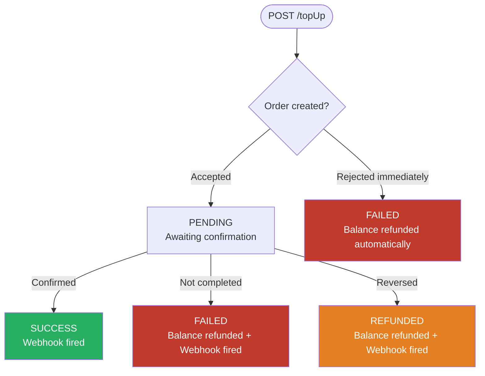

# Topon API Integration Guide v1.13

## Overview

The Topon API is a RESTful gaming digital goods platform for integrating direct game top-ups and voucher purchases. All requests are authenticated via an API token; responses are JSON.

## What changed in v1.13

- **Manage your IP whitelist yourself.** In the reseller portal, **API Integration → Settings → API keys & IP whitelist** lists your API keys (masked) and lets you choose, for each key, the IP addresses it can be used from. See [IP Whitelist](#ip-whitelist).
- **Manage your callback URL and signing secret yourself.** Your callback URL, its custom headers and the signing secret are now set in the reseller portal (**API Integration → Settings → Callback URL**). See [Registration](#registration) and [Signature / Verification](#signature-verification).
- **Authentication errors corrected.** An invalid or missing token, or a request from an IP address that isn't on the token's whitelist, returns **`401`**, not `404` as earlier versions said. See [Authentication](#authentication).
- **Callback delivery:** redirects are not followed, and callback URLs must point to a public address. See [Retry Behaviour](#retry-behaviour).

## What changed in v1.12

- **Gzip compression for catalog responses.** Send `Accept-Encoding: gzip` and `/getProducts` and `/getProductsFiltered` return a compressed body, typically 80–85% smaller. Recommended for every integration; requests without the header are unchanged. See [Response Compression](#response-compression).
- **Price update schedule documented.** Prices are updated once per hour and are available from 5 minutes past the hour. Refresh the catalog once per hour after `xx:05`; polling more often does not return newer prices. See [Price Update Schedule](#price-update-schedule).
- **AI assistant prompt.** A ready-to-paste prompt for building the integration with Claude or another AI coding assistant. See [Building with an AI Assistant](#building-with-an-ai-assistant).

## What changed in v1.11

- **`merchant_txn_id` is an idempotency key.** v1.10 contained a leftover sentence saying it was "not an idempotency key"; that was wrong and has been removed. Duplicate protection is live in both development and production. See [Idempotency](#idempotency) for the full contract, now including expiry, concurrent requests, and payload mismatches.
- **New `409` response on `/topUp`** when a request with the same `merchant_txn_id` is still being processed.
- **`CANCELLED` removed.** It was never a status Topon produces. The final statuses are `SUCCESS`, `FAILED` and `REFUNDED`.
- **New section: [Recovering from a timeout](#recovering-from-a-timeout)**, a step-by-step reconciliation procedure.
- **New dev-only testing controls:** an optional `"manual_result": true` on `/topUp` keeps a development order `PENDING`, and `POST /simulateResult/{transactionId}` then drives it to `SUCCESS`, `FAILED`, `REFUNDED` or a delayed result. See [Testing Environment](#testing-environment).
- `/topUp` now returns `400` for a missing `sku` and `412` for an unknown SKU (previously both could return `500`).

## Base URLs

| Environment | URL |
|---|---|
| Development | `https://dev-api.topon.app` |
| Production | `https://api.topon.app` |

Development and production are fully separate: different API tokens, merchant accounts, balances, catalogs and webhook configuration.

Each API token can be restricted to your servers' IP addresses. You set this yourself in the reseller portal; see [IP Whitelist](#ip-whitelist).

## Quick Start

1. **Load the product catalog** with `GET /getProducts` (send `Accept-Encoding: gzip`, see [Response Compression](#response-compression)). Store each product's `fields` array and SKU list. Refresh it once per hour, after 5 minutes past the hour (see [Price Update Schedule](#price-update-schedule)).
2. **Collect user inputs** for the fields listed in the product's `fields` array (e.g. `User`, `Server`).
3. **Submit the order** with `POST /topUp`, always including a unique `merchant_txn_id`. On success the transaction enters `PENDING` state.
4. **Receive the outcome** via webhook. The transaction ends as `SUCCESS`, `FAILED` or `REFUNDED`.

---

<a name="building-with-an-ai-assistant"></a>
## Building with an AI Assistant

If you use Claude or another AI coding assistant, copy the prompt below into a new conversation and attach this file (`API_DOCUMENTATION.md`). Fill in the three lines under "About my project". The prompt points the assistant at the parts of the integration that are easy to get wrong and can cost money: idempotency, timeouts, final statuses and webhook verification.

```text
You are a senior backend engineer helping me integrate the Topon API, a platform for buying game top-ups and gift-card vouchers. The attached API_DOCUMENTATION.md is the only source of truth. Do not invent endpoints, fields, status codes or behaviour that are not in it. If the document doesn't answer something, say so and ask me instead of guessing.

About my project:
- Language / framework: <e.g. Node.js + Express, Python + Django, PHP + Laravel>
- Database / storage: <e.g. PostgreSQL, MySQL, MongoDB>
- What I'm building: <e.g. a storefront where customers buy game credits; we fulfil orders through Topon>

Build the integration in this order, and show me each part before moving on:
1. A Topon API client: base URL and token from configuration (never hard-coded), the `authorizationtoken` header, timeouts of 30s for reads and 40s for /topUp, and connection reuse.
2. Catalog sync: GET /getProducts with gzip, cached and refreshed once per hour after xx:05. Store each product's `fields`, `serverlist` and SKUs, and honour `disabled: true`.
3. Order placement with POST /topUp, including timeout recovery.
4. A webhook endpoint for transaction callbacks.
5. A reconciliation job and a balance check.
6. Tests against the development environment.

Rules you must follow. They protect against double charges and wrong deliveries:
- Generate a unique `merchant_txn_id` for every order (one per item, so 3 units = 3 references) and save it in my database BEFORE calling /topUp.
- A timeout, connection error, 5xx or unreadable /topUp response means the outcome is UNKNOWN. Resend the identical request with the SAME `merchant_txn_id`, using backoff (2s, 5s, 10s, 30s). A 409 means it is still being processed: wait and resend. Never retry under a new reference, and never resend a reference older than 7 days.
- A `merchant_txn_id` whose order ended FAILED or REFUNDED is released, so resending it creates a NEW, charged order. Only resend it when I really want to re-attempt the order.
- HTTP 200 from /topUp only means the order was accepted (PENDING). The word "SUCCESS" in `message` is not the final status. A `"duplicate": true` response doesn't include a status either.
- Get the final status only from the webhook or GET /getTransaction/{transactionId}. The final statuses are SUCCESS, FAILED and REFUNDED. FAILED and REFUNDED both mean the customer did NOT get the goods, so handle them identically. A PENDING callback is informational only.
- Verify `X-Topon-Signature` (hex HMAC-SHA256 over the RAW request body) with a constant-time comparison before parsing the JSON. Reject with 401 if it is missing or wrong. If I tell you my URL is unsigned, validate my custom secret header instead.
- The webhook must return HTTP 200 with {"status": "success"} quickly and do the heavy work asynchronously. Deduplicate events on transactionId + status, because callbacks can be redelivered. Make the fulfilment and refund logic idempotent.
- Send each entry of the product's `fields` array as its own top-level key with the exact capitalisation ("User", "Server", "PlayerIP"). A `Server` value must be copied exactly from `serverlist`.
- Parse `usdPrice` and `usdBalance` as decimals, never as floats.
- /validateUser returns `status` as the STRING "true" or "false", usually with HTTP 200. A passed validation is not a guarantee that the top-up will succeed.
- HTTP 401 "Unauthorized" means the token is missing or invalid, or the request came from an IP address that isn't on the key's IP whitelist. It is not a missing resource, and nothing was charged.
- Don't poll /getSku per SKU or refresh the catalog more often than hourly. On a 412 from /topUp, refresh the catalog.
- Store voucher codes encrypted at rest. Don't log end-customer personal data or the API token.
- `manual_result` and /simulateResult exist only in development. Keep them out of production code paths, for example behind an environment check.

For the tests, use the "Test scenarios" table in the document: success, voucher delivered, failed later, refunded, duplicate protection, concurrent duplicates, retry after failure, timeout recovery and signature rejection.

Before writing any code, ask me any questions you need answered, such as how my order and refund flow works today and whether my webhook URL is signed. Then propose a short plan and the database changes (for example an orders table with merchant_txn_id, topon_transaction_id, status, voucher and timestamps).
```

---

## Authentication

Pass your API token in the `authorizationtoken` request header on every call:

```
authorizationtoken: YOUR_API_TOKEN
```

An invalid or missing token returns **HTTP 401** with `{"message":"Unauthorized"}`.

A request with a valid token from an IP address that isn't on the token's [IP whitelist](#ip-whitelist) gets exactly the same `401`. The response deliberately doesn't say which check failed. No order is created and nothing is charged. If your token works from one server and gets `401` from another, add that server's IP address to the whitelist.

<a name="ip-whitelist"></a>
### IP Whitelist

In the reseller portal, go to **API Integration → Settings → API keys & IP whitelist**. Every API key on your account is listed, masked (only the first and last 4 characters are shown), and each key has its own whitelist:

- **Add one IP address at a time**, IPv4 or IPv6 (e.g. `203.0.113.10`). It is stored as a single address (`203.0.113.10/32`, or `/128` for IPv6). Ranges aren't accepted; add each server separately.
- **Allow all** lets the key be used from any IPv4 or IPv6 address. Keys usually start this way. We recommend replacing it with your servers' addresses before going live.
- Saving asks for your portal password. Every change is emailed to your account address.
- The change applies to the next request. Add a new server's address **before** you switch traffic to it.
- Development and production keys are separate, and each has its own whitelist.

The whitelist is checked against the address Topon sees the request come from. If your servers send requests through a proxy, NAT gateway or load balancer, whitelist its outgoing (public) IP address.

---

<a name="response-compression"></a>
## Response Compression

**Recommended.** The full catalog is several hundred KB of JSON. Send `Accept-Encoding: gzip` and Topon returns it gzip-compressed with a `Content-Encoding: gzip` response header, typically **80–85% smaller** and faster to download.

```
Accept-Encoding: gzip
```

- Applies to `/getProducts` and `/getProductsFiltered`. Other endpoints, and very small responses (under 1 KB), are always returned uncompressed. Rely on the `Content-Encoding` response header rather than assuming either way.
- It is opt-in. Requests without the header get exactly the same uncompressed JSON as before.
- The decompressed body is byte-for-byte the same JSON as the uncompressed response.

Most HTTP clients send the header and decompress for you:

| Client | What to do |
|---|---|
| Browsers | Nothing. Browsers always send it and decompress automatically. |
| cURL | Add `--compressed` |
| Python `requests` / `httpx` | Nothing. Both send `Accept-Encoding: gzip` by default and decompress automatically. |
| Node.js `fetch` (18+) / `axios` | Nothing. Both send it by default and decompress automatically. |
| PHP cURL | `curl_setopt($ch, CURLOPT_ENCODING, '');` enables it and decompresses automatically |
| .NET `HttpClient` | Set `AutomaticDecompression = DecompressionMethods.GZip` on the `HttpClientHandler` |
| Java `java.net.http.HttpClient` | Not automatic. Add the header and wrap the body in a `GZIPInputStream` (OkHttp does this for you) |

> Only send `Accept-Encoding: gzip` by hand if your client decompresses responses. Otherwise you will receive binary gzip data instead of JSON.

**cURL**:
```bash
curl --compressed 'https://api.topon.app/getProducts' \
  -H 'authorizationtoken: YOUR_API_TOKEN'
```

---

<a name="price-update-schedule"></a>
## Price Update Schedule

Prices are updated **once per hour**, at the top of the hour. The updated catalog is available from **5 minutes past the hour (`xx:05`)**.

- **Refresh the catalog once per hour**, at any time after `xx:05`, with `/getProducts` or `/getProductsFiltered`.
- **Polling more often does not get you newer prices.** You do not need to refresh every few minutes, and you do not need to poll `/getSku/{sku}` per SKU to track prices.
- **The price charged is always the current price.** `/topUp` checks the current price and availability when the order is placed. A SKU that became unavailable since your last refresh returns `412` (`"Sku temporarily unavailable"`), so you don't need to poll to catch availability changes either. Refresh the catalog when you get one.

---

## Transaction Lifecycle



### States

| Status | Final? | Description | Balance |
|---|---|---|---|
| `INITIATED` | No | Being created; you may briefly see it on a lookup while `/topUp` is still running | Deducted |
| `PENDING` | No | Order accepted, awaiting confirmation | Deducted |
| `SUCCESS` | Yes | Order completed successfully | Deducted (final) |
| `FAILED` | Yes | Order could not be completed, either immediately or later | **Refunded** |
| `REFUNDED` | Yes | Order was reversed after it was accepted | **Refunded** |

**Key points:**
- `POST /topUp` returns **HTTP 200** when the order is accepted (now `PENDING`), or **HTTP 422** when it fails immediately (`FAILED`, balance already refunded).
- The `/topUp` response never tells you the final `SUCCESS`. Get the final outcome from a webhook or a [transaction lookup](#10-get-single-transaction) in every environment.
- `FAILED` and `REFUNDED` are both final, both refund your balance automatically, and both mean the end customer did **not** receive the goods. Treat them the same way in your fulfilment logic.

---

## Webhook Callbacks

### Registration

Webhooks are configured per merchant account, separately for development and production. Set your callback URL in the reseller portal under **API Integration → Settings → Callback URL**, optionally with custom HTTP headers (e.g. an `Authorization` or `X-Topon-Secret` header for your endpoint's own authentication). Saving asks for your portal password, and every change is emailed to your account address.

- The URL must use `https://` and point to a public address. Local, private and internal addresses are refused.
- Removing the URL turns callbacks off; you then check status with [`/getTransaction`](#10-get-single-transaction).
- One callback URL per account.

<a name="signature-verification"></a>
### Signature / Verification

**HMAC signing (recommended).** Turn it on in the reseller portal under **API Integration → Settings → Callback URL → Signing secret**: **Turn on signing** generates a webhook secret, **Show** displays it again, and **Generate new secret** replaces it. Each of these asks for your portal password. Development and production accounts have different secrets. With signing on, every callback carries an `X-Topon-Signature` header:

```
X-Topon-Signature: hex( HMAC-SHA256( webhook_secret, raw_request_body ) )
```

To verify:
1. Read the **raw** request body bytes before any JSON parsing. Re-serializing the parsed JSON will not reproduce the same bytes.
2. Compute HMAC-SHA256 over those bytes with your webhook secret, hex-encoded (lowercase).
3. Compare it to the `X-Topon-Signature` header using a constant-time comparison. Reject the request (e.g. HTTP 401) if the header is missing or doesn't match.

> **Replacing the secret takes effect immediately.** Callbacks from then on are signed with the new secret only, so your endpoint will reject them until you update it there. Rejected callbacks are retried as described in [Retry Behaviour](#retry-behaviour) and then dropped, so update your server right after generating a new secret (you can always check status with [`/getTransaction`](#10-get-single-transaction)). Every new secret is emailed to your account address as a notice (the secret itself is never emailed).

Callbacks without a webhook secret are not signed. In that case, protect your endpoint by registering a custom secret header (e.g. `X-Topon-Secret: <your-secret>`) and validating it on every inbound request.

In all cases:
- Use HTTPS with TLS certificate validation.
- Optionally restrict inbound traffic to Topon's production callback source IP (`54.251.87.79`). Development callbacks come from a different IP; ask the Topon team for it.

### Retry Behaviour

A delivery counts as successful when your endpoint returns an **HTTP 2xx** response. Failed deliveries (non-2xx response, connection error, or timeout) are retried up to **3 times** with a **30-second timeout** per attempt. Redirects are **not followed**: a `3xx` response counts as a failed delivery, so register the final URL. A URL whose host resolves to a private or internal address is not called. After all retries are exhausted, the event goes to a dead-letter queue for manual investigation. If you miss a callback, the transaction lookup endpoints always return the current status.

Because of retries, the same event can be delivered more than once. Deduplicate on `transactionId` + `status`.

### Payload

Callbacks are `POST` requests with `Content-Type: application/json`. Respond with **HTTP 200** and `{"status": "success"}`.

**Success**:
```json
{
  "status": "SUCCESS",
  "transactionId": "550e8400-e29b-41d4-a716-446655440000",
  "voucher": "ABC123DEF456",
  "merchant_txn_id": "your-order-ref-001"
}
```

`voucher` is only present for voucher-type products.

**Failed**:
```json
{
  "status": "FAILED",
  "transactionId": "550e8400-e29b-41d4-a716-446655440000",
  "merchant_txn_id": "your-order-ref-001"
}
```

**Refunded**:
```json
{
  "status": "REFUNDED",
  "transactionId": "550e8400-e29b-41d4-a716-446655440000",
  "merchant_txn_id": "your-order-ref-001"
}
```

`merchant_txn_id` is echoed back only when you supplied it at top-up time.

A `PENDING` callback may also be sent while an order is still in progress (for example, when the account details need attention). It is informational only. Keep waiting for a final `SUCCESS`, `FAILED` or `REFUNDED` event.

### Callback Handler Examples

**Python / Flask**:
```python
import hashlib
import hmac

from flask import Flask, request, jsonify

app = Flask(__name__)
WEBHOOK_SECRET = b'YOUR_WEBHOOK_SECRET'

@app.route('/webhook/topon', methods=['POST'])
def handle_topon_callback():
    raw_body = request.get_data()  # raw bytes — verify before parsing
    expected = hmac.new(WEBHOOK_SECRET, raw_body, hashlib.sha256).hexdigest()
    received = request.headers.get('X-Topon-Signature', '')
    if not hmac.compare_digest(expected, received):
        return jsonify({'error': 'Invalid signature'}), 401

    data = request.get_json()
    transaction_id = data['transactionId']
    status = data['status']

    if status == 'SUCCESS':
        voucher = data.get('voucher')  # present for voucher products
        # fulfil the order, store voucher if present
    elif status in ('FAILED', 'REFUNDED'):
        pass  # not delivered — refund the customer
    # 'PENDING' is informational; keep waiting

    return jsonify({'status': 'success'}), 200
```

**Node.js / Express**:
```javascript
const crypto = require('crypto');
const express = require('express');
const app = express();

// Keep the raw body so the signature can be verified
app.post('/webhook/topon', express.raw({ type: 'application/json' }), (req, res) => {
    const expected = crypto
        .createHmac('sha256', process.env.TOPON_WEBHOOK_SECRET)
        .update(req.body)
        .digest('hex');
    const received = req.get('X-Topon-Signature') || '';
    if (received.length !== expected.length ||
        !crypto.timingSafeEqual(Buffer.from(received), Buffer.from(expected))) {
        return res.status(401).json({ error: 'Invalid signature' });
    }

    const { transactionId, status, voucher, merchant_txn_id } = JSON.parse(req.body);

    if (status === 'SUCCESS') { /* fulfil */ }
    else if (status === 'FAILED' || status === 'REFUNDED') { /* refund the customer */ }
    // 'PENDING' is informational; keep waiting

    res.status(200).json({ status: 'success' });
});
```

If your URL is not signed, replace the signature check with a check of your registered custom header.

---

## API Endpoints

### 1. Get All Products

**`GET /getProducts`**

Returns the full product catalog with all SKUs and pricing for your account. This is the primary catalog endpoint; use it to keep your product list and prices in sync.

> Refresh the catalog once per hour, after `xx:05` (see [Price Update Schedule](#price-update-schedule)). Do not call this per transaction. Send `Accept-Encoding: gzip` to receive a much smaller response (see [Response Compression](#response-compression)).

**cURL**:
```bash
curl --compressed 'https://api.topon.app/getProducts' \
  -H 'authorizationtoken: YOUR_API_TOKEN'
```

**Python** (`requests` sends `Accept-Encoding: gzip` and decompresses automatically):
```python
response = requests.get(
    'https://api.topon.app/getProducts',
    headers={'authorizationtoken': 'YOUR_API_TOKEN'}
)
```

**Response**:
```json
{
  "products": [
    {
      "productName": "Garena Free Fire (ID)",
      "fields": ["User"],
      "skus": [
        {
          "sku": "garena_free_fire_id_50_diamonds",
          "description": "Garena Free Fire (ID) - 50 Diamonds",
          "usdPrice": "0.41"
        },
        {
          "sku": "garena_free_fire_id_12_diamonds",
          "description": "Garena Free Fire (ID) - 12 Diamonds",
          "usdPrice": "0.12",
          "disabled": true
        }
      ]
    },
    {
      "productName": "Honkai: Star Rail",
      "fields": ["User", "Server"],
      "serverlist": ["Asia", "America", "Europe", "TW,HK,MO"],
      "skus": [
        {
          "sku": "honkai_star_rail_300_30_onieric_shard",
          "description": "Honkai Star Rail - 300+30 Oneiric Shard",
          "usdPrice": "3.36"
        }
      ]
    },
    {
      "productName": "Some Game with Extra Fields",
      "fields": ["User", "Server", "PlayerIP"],
      "serverlist": ["NA", "EU"],
      "skus": []
    }
  ]
}
```

**Understanding the `fields` array**

The `fields` array tells you exactly which inputs to collect from the user:

| `fields` | Required inputs |
|---|---|
| `["User"]` | User ID only |
| `["User", "Server"]` | User ID + server selection |
| `["User", "Server", "PlayerIP"]` | User ID + server + player IP |

Send each field as its own top-level key when calling `/topUp` or `/validateUser`, using the exact capitalisation shown (e.g. `"User"`, `"Server"`). When a product has a `serverlist`, the `Server` value must be one of its entries, copied exactly.

`disabled: true` on a SKU means it is temporarily unavailable. `usdPrice` is a decimal string; parse it as a decimal rather than a float.

---

### 2. Get Filtered Products

**`POST /getProductsFiltered`**

Same response shape as `/getProducts`, but limited to the products you specify. Useful when you only care about a subset of the catalog.

**Request body**:
```json
{
  "products": ["Honkai: Star Rail", "Garena Free Fire (ID)"]
}
```

**cURL**:
```bash
curl --compressed -X POST 'https://api.topon.app/getProductsFiltered' \
  -H 'authorizationtoken: YOUR_API_TOKEN' \
  -H 'Content-Type: application/json' \
  -d '{"products": ["Honkai: Star Rail", "Garena Free Fire (ID)"]}'
```

An empty or missing `products` list returns the full catalog (identical to `GET /getProducts`). Unknown product names are silently ignored.

---

### 3. Top-Up

**`POST /topUp`**

Submits a top-up order.

**Field format**: Send each entry from the product's `fields` array as its own key, using the exact capitalisation shown in the catalog (`"User"`, `"Server"`, etc.).

**Request body**:
```json
{
  "sku": "honkai_star_rail_300_30_onieric_shard",
  "User": "702828588",
  "Server": "Asia",
  "merchant_txn_id": "your-order-ref-001"
}
```

| Key | Required | Description |
|---|---|---|
| `sku` | Yes | SKU identifier from the catalog |
| *each entry of `fields`* | Yes | e.g. `User`, `Server`, `PlayerIP` |
| `merchant_txn_id` | Strongly recommended | Your unique reference for this order. It is the **idempotency key** that makes the call safe to retry; see [Idempotency](#idempotency). Without it, a retry after a timeout can charge you twice. |
| `manual_result` | Development only | `true` keeps the order `PENDING` for [`/simulateResult`](#simulate-a-result-dev-only). Ignored in production. |

**cURL**:
```bash
curl -X POST 'https://api.topon.app/topUp' \
  -H 'authorizationtoken: YOUR_API_TOKEN' \
  -H 'Content-Type: application/json' \
  -d '{"sku": "honkai_star_rail_300_30_onieric_shard", "User": "702828588", "Server": "Asia", "merchant_txn_id": "your-order-ref-001"}'
```

**Python**:
```python
response = requests.post(
    'https://api.topon.app/topUp',
    headers={
        'authorizationtoken': 'YOUR_API_TOKEN',
        'Content-Type': 'application/json'
    },
    json={
        'sku': 'honkai_star_rail_300_30_onieric_shard',
        'User': '702828588',
        'Server': 'Asia',
        'merchant_txn_id': 'your-order-ref-001'
    },
    timeout=40
)
```

**Responses**:

| HTTP | Meaning | Charged? | Transaction created? |
|---|---|---|---|
| 200 | Order accepted | Yes | Yes, `PENDING` |
| 200 + `"duplicate": true` | This `merchant_txn_id` already has an order. Nothing new was created; you get the original. | No (not again) | No, returns the existing one |
| 400 | Missing `sku` or malformed request | No | No |
| 402 | Insufficient balance | No | No (or `FAILED`) |
| 403 | Product not available for your account | No | No |
| 409 | A request with the same `merchant_txn_id` is still being processed. Retry in a few seconds. | No | No |
| 412 | SKU unknown or temporarily disabled | No | No |
| 422 | Order rejected; balance refunded | No (refunded) | Yes, `FAILED` |
| 429 | Daily volume limit reached for this product | No | No |
| 5xx / timeout | Outcome **unknown**. Follow [Recovering from a timeout](#recovering-from-a-timeout). | Unknown | Unknown |

**HTTP 200 — Order accepted** (transaction is now `PENDING`):
```json
{
  "transactionId": "550e8400-e29b-41d4-a716-446655440000",
  "message": "Topped up SUCCESS for 702828588 with sku honkai_star_rail_300_30_onieric_shard",
  "usdBalance": "48.50"
}
```

> The transaction is `PENDING` at this point. `SUCCESS` is delivered asynchronously via webhook. Some products complete in seconds; others may take up to one hour.

> Don't read the word `SUCCESS` in `message` as the final transaction status. HTTP 200 only means the order was accepted.

**HTTP 422 — Order failed** (balance has been refunded):
```json
{
  "transactionId": "550e8400-e29b-41d4-a716-446655440000",
  "message": "Topped up FAILED for 702828588 with sku honkai_star_rail_300_30_onieric_shard",
  "usdBalance": "50.00"
}
```

**HTTP 409 — Same reference still in progress**:
```json
{
  "merchant_txn_id": "your-order-ref-001",
  "message": "A request with this merchant_txn_id is still being processed. No new order was created. Retry in a few seconds."
}
```

<a name="idempotency"></a>
#### Idempotency

`merchant_txn_id` is an idempotency key, scoped to your merchant account. Another merchant using the same string does not collide with yours.

**How it works.** The reference is claimed atomically *before* anything is charged. Then:

| You send `/topUp` with a reference that… | Result |
|---|---|
| has never been used (or has expired, see below) | Processed normally |
| belongs to an order that is `INITIATED`, `PENDING` or `SUCCESS` | **No new order, no charge.** `200` with the original `transactionId` and `"duplicate": true` |
| belongs to a request that is still being created (a concurrent duplicate) | **No new order, no charge.** `409`; retry shortly and you will get the `duplicate` response |
| belongs to an order that ended `FAILED` or `REFUNDED` | The reference has been released, so this is processed as a **new, charged order** |

**Duplicate response** (HTTP 200):
```json
{
  "transactionId": "550e8400-e29b-41d4-a716-446655440000",
  "merchant_txn_id": "your-order-ref-001",
  "duplicate": true,
  "message": "A transaction already exists for this merchant_txn_id. No new order was created.",
  "usdBalance": "48.50"
}
```

This is a `200`, not an error: a retry after a timeout gets the same answer the original call would have. The duplicate response does **not** include the order's status. Use the returned `transactionId` with [`GET /getTransaction/{transactionId}`](#10-get-single-transaction) or wait for the webhook, because the original order may still end up `FAILED`.

**Details you should know:**

- **Concurrent requests.** If two requests with the same reference arrive at the same time, exactly one is processed. The other gets `200 duplicate` or `409`, and is never charged.
- **Different payload, same reference.** The payload is **not** compared. A second request with the same reference but a different `sku` or `User` does not create an order. It returns the original transaction unchanged. Never reuse a reference for a different order.
- **Release after `FAILED`/`REFUNDED`.** Once the original order is final and unsuccessful, the same reference can be used again and **will be charged as a new order**. This applies even to a delayed retry hours later. If you don't want a failed order re-attempted, don't resend its reference.
- **Expiry.** Duplicate protection lasts **7 days** from the original request. After that the reference may be accepted as a new order. Never resend a reference older than 7 days.
- **Multiple items.** If a customer buys three of the same SKU, use three different references. Reusing one makes the second and third look like retries of the first, and they won't be delivered.
- **Degraded mode.** If Topon's duplicate-protection store is briefly unavailable, orders are still accepted rather than rejected, without the duplicate check. This is very rare, but it's another reason to reconcile with the lookup endpoints rather than assume a retry is always deduplicated.

<a name="recovering-from-a-timeout"></a>
#### Recovering from a timeout

If `/topUp` times out, the connection drops, or you get a 5xx or an unreadable response, you **don't know** whether the order was created. Do this:

1. **Resend the identical request with the same `merchant_txn_id`.** The duplicate check is strongly consistent, so this is the authoritative test:
   - `200` with `"duplicate": true`: the original was created. Use its `transactionId`.
   - `200` without `duplicate`: the original never got through, and *this* call created the order.
   - `409`: the original is still being processed. Wait 2–5 seconds and resend again.
   - `402`/`403`/`412`/`422`/`429`: handle it like a normal response. No order exists under this reference except, for `422`, the failed one.
2. **Follow up by `transactionId`** using `GET /getTransaction/{transactionId}` until the status is final, or wait for the webhook.
3. **Limit your retries.** Use backoff (for example 2s, 5s, 10s, 30s). If you still have no answer, stop and reconcile with `GET /getTransaction?merchant_txn_id=…` and the webhook before trying anything else. Never resend after the 7-day protection window.

**Don't** treat a `412` from `GET /getTransaction?merchant_txn_id=…` as proof that the order wasn't created. The lookup by reference is backed by an index that can lag a few seconds behind, and a `/topUp` that is still running may not have written its transaction yet. Use step 1 instead.

**Never** send a timed-out order again under a *new* `merchant_txn_id`. That is the one way to be charged twice.

---

### 4. Check Balance

**`GET /checkBalance`**

Returns the current USD balance for your account.

**cURL**:
```bash
curl 'https://api.topon.app/checkBalance' \
  -H 'authorizationtoken: YOUR_API_TOKEN'
```

**Response**:
```json
{
  "usdBalance": "50.00"
}
```

---

### 5. Get Transaction Details List

**`GET /getTransactionsDetails/from/{datefrom}/to/{dateto}`**

Returns detailed transaction information within a date range. Use it for daily reconciliation.

**Parameters**:
- `datefrom`: Start date in `YYYYMMDD` format
- `dateto`: End date in `YYYYMMDD` format (maximum range: 180 days from the start date)

Both dates must be valid calendar dates, and `datefrom` cannot be after `dateto`. Date validation errors currently return HTTP 402; see [Error Handling](#error-handling).

**cURL**:
```bash
curl 'https://api.topon.app/getTransactionsDetails/from/20251001/to/20251031' \
  -H 'authorizationtoken: YOUR_API_TOKEN'
```

**Python**:
```python
response = requests.get(
    'https://api.topon.app/getTransactionsDetails/from/20251001/to/20251031',
    headers={'authorizationtoken': 'YOUR_API_TOKEN'}
)
```

**Response**:
```json
{
  "transactions": [
    {
      "transactionId": "550e8400-e29b-41d4-a716-446655440000",
      "order_date": "2025-10-15T10:30:00.000Z",
      "status": "SUCCESS",
      "user": "123456789_2001",
      "price": "1.50",
      "skuId": "MLBB_60_DIAMONDS_MY",
      "voucher": "ABC123DEF456",
      "merchant_txn_id": "your-order-ref-001"
    },
    {
      "transactionId": "6ba7b810-9dad-11d1-80b4-00c04fd430c8",
      "order_date": "2025-10-15T11:45:00.000Z",
      "status": "FAILED",
      "user": "987654321_2002",
      "price": "3.00",
      "skuId": "MLBB_120_DIAMONDS_MY",
      "reason": "Invalid account"
    }
  ]
}
```

`merchant_txn_id` is included only for transactions where you supplied it at top-up time.

---

### 6. Get SKU Details

**`GET /getSku/{sku}`**

> All SKUs are already returned by `/getProducts`; you don't need to fetch them one by one. Don't poll this endpoint per SKU to track prices: prices change once per hour (see [Price Update Schedule](#price-update-schedule)).

Returns the details of a single SKU, including price and availability.

**cURL**:
```bash
curl 'https://api.topon.app/getSku/garena_free_fire_id_12_diamonds' \
  -H 'authorizationtoken: YOUR_API_TOKEN'
```

**Response**:
```json
{
  "sku": {
    "sku": "garena_free_fire_id_12_diamonds",
    "description": "Garena Free Fire (ID) - 12 Diamonds",
    "productName": "Garena Free Fire (ID)",
    "usdPrice": "0.12",
    "disabled": true
  }
}
```

`disabled` is included when the SKU has an availability flag. `true` means the SKU is temporarily unavailable.

---

### 7. Get Product Details

**`GET /getProduct`**

> All products are already returned by `/getProducts`; you don't need to fetch them one by one. Because this endpoint takes a JSON body on a `GET`, which some HTTP clients and proxies drop, prefer `POST /getProductsFiltered` with a single product name.

Returns a single product, including its server list and required fields.

**Request body**:
```json
{
  "productName": "Honkai: Star Rail"
}
```

**cURL**:
```bash
curl -X GET 'https://api.topon.app/getProduct' \
  -H 'authorizationtoken: YOUR_API_TOKEN' \
  -H 'Content-Type: application/json' \
  -d '{"productName": "Honkai: Star Rail"}'
```

**Response**:
```json
{
  "product": {
    "productName": "Honkai: Star Rail",
    "user": "User_Server",
    "fields": ["User", "Server"],
    "serverlist": ["Asia", "America", "Europe", "TW,HK,MO"]
  },
  "skus": [
    {
      "sku": "honkai_star_rail_300_30_onieric_shard",
      "description": "Honkai Star Rail - 300+30 Oneiric Shard",
      "usdPrice": "3.36"
    },
    {
      "sku": "honkai_star_rail_6480_1600_onieric_shard",
      "description": "Honkai Star Rail - 6480+1600 Oneiric Shard",
      "usdPrice": "66.86"
    }
  ]
}
```

---

### 8. Validate User Account

**`POST /validateUser`**

Checks whether a user account exists and can receive a top-up for a specific SKU. Validation is not available for every product, so a successful validation is not a guarantee that the top-up will succeed.

**Request body**: send each field from the product's `fields` array as its own key, with the **exact name and capitalisation** from the catalog (same rule as `/topUp`).

```json
{
  "sku": "honkai_star_rail_express_supply_pass",
  "User": "702828588",
  "Server": "Europe"
}
```

**cURL**:
```bash
curl -X POST 'https://api.topon.app/validateUser' \
  -H 'authorizationtoken: YOUR_API_TOKEN' \
  -H 'Content-Type: application/json' \
  -d '{"sku": "honkai_star_rail_express_supply_pass", "User": "702828588", "Server": "Europe"}'
```

**Success response**:
```json
{
  "status": "true",
  "message": "Account has been validated.",
  "user": "123456789",
  "server": "2001",
  "country": "MY"
}
```

**Error responses**:
```json
{ "status": "false", "message": "Invalid User ID / Server" }
```
```json
{ "status": "false", "message": "Missing Server and PlayerIP" }
```
```json
{ "status": "false", "message": "Invalid Server" }
```

Validation failures normally return HTTP 200. Always check the **string** `status` field: `"false"` means validation failed.

---

### 9. Get Transaction List

**`GET /getTransactions/from/{datefrom}/to/{dateto}`**

Returns the transaction IDs within a date range. Same date rules as [Get Transaction Details List](#5-get-transaction-details-list).

**cURL**:
```bash
curl 'https://api.topon.app/getTransactions/from/20251001/to/20251031' \
  -H 'authorizationtoken: YOUR_API_TOKEN'
```

**Response**:
```json
{
  "transactions": [
    "550e8400-e29b-41d4-a716-446655440000",
    "6ba7b810-9dad-11d1-80b4-00c04fd430c8"
  ]
}
```

---

### 10. Get Single Transaction

**Endpoints**:
- `GET /getTransaction/{transactionId}`: look up by Topon transaction ID. **Preferred**; reflects the latest status immediately.
- `GET /getTransaction?merchant_txn_id={merchant_txn_id}`: look up by your own reference. Can lag a few seconds behind a just-created order (see [Recovering from a timeout](#recovering-from-a-timeout)).

Provide exactly one of the two.

A `merchant_txn_id` can map to more than one transaction: the reference is released when its transaction ends `FAILED` or `REFUNDED`, so a genuinely failed order can be retried under the same reference. Every matching transaction is returned in `transactions`, newest first. `transaction` carries the newest match, so integrations that read only that field keep working unchanged.

**cURL** (by transaction ID):
```bash
curl 'https://api.topon.app/getTransaction/550e8400-e29b-41d4-a716-446655440000' \
  -H 'authorizationtoken: YOUR_API_TOKEN'
```

**cURL** (by merchant_txn_id):
```bash
curl 'https://api.topon.app/getTransaction?merchant_txn_id=your-order-ref-001' \
  -H 'authorizationtoken: YOUR_API_TOKEN'
```

**Response** (a reference retried after the first attempt was refunded):
```json
{
  "transaction": {
    "transactionId": "550e8400-e29b-41d4-a716-446655440000",
    "order_date": "2025-10-16T08:12:00.000Z",
    "status": "SUCCESS",
    "user": "123456789_2001",
    "price": "1.50",
    "skuId": "MLBB_60_DIAMONDS_MY",
    "voucher": "ABC123DEF456",
    "merchant_txn_id": "your-order-ref-001"
  },
  "transactions": [
    {
      "transactionId": "550e8400-e29b-41d4-a716-446655440000",
      "order_date": "2025-10-16T08:12:00.000Z",
      "status": "SUCCESS",
      "user": "123456789_2001",
      "price": "1.50",
      "skuId": "MLBB_60_DIAMONDS_MY",
      "voucher": "ABC123DEF456",
      "merchant_txn_id": "your-order-ref-001"
    },
    {
      "transactionId": "f13c2b90-7a41-4de1-9c02-1b8e5d9a4c77",
      "order_date": "2025-10-15T10:30:00.000Z",
      "status": "REFUNDED",
      "user": "123456789_2001",
      "price": "1.50",
      "skuId": "MLBB_60_DIAMONDS_MY",
      "merchant_txn_id": "your-order-ref-001"
    }
  ]
}
```

`transactions` is always present and always newest first; a lookup by `transactionId` returns a single-element list. `voucher` and `merchant_txn_id` are included only when they apply. If no transaction matches, HTTP `412` is returned.

---

## Error Handling

### HTTP Status Codes

| HTTP | Meaning |
|---|---|
| 200 | Request completed. For `/topUp`, check for `"duplicate": true`. For `/validateUser`, check the response `status` field. |
| 400 | Invalid or missing request parameters. |
| 402 | Insufficient balance. The transaction-list endpoints also currently use 402 for invalid dates or ranges. |
| 403 | Product or account is not available to this merchant. |
| 401 | Authentication failed: invalid or missing token, or the source IP isn't on the token's [IP whitelist](#ip-whitelist). Nothing was charged. |
| 409 | `/topUp`: a request with the same `merchant_txn_id` is still in progress. Retry shortly. |
| 412 | Invalid or unavailable SKU, or transaction not found. |
| 422 | Top-up failed after the transaction was created; the deducted balance was refunded. |
| 429 | Daily product volume limit reached. |
| 500 | Internal server error. For `/topUp`, treat it as an unknown outcome and follow [Recovering from a timeout](#recovering-from-a-timeout). |

### Common Error Responses

**Invalid SKU (412)**:
```json
{ "message": "Invalid sku" }
```

**SKU temporarily unavailable (412)**:
```json
{ "message": "Sku temporarily unavailable" }
```

**Insufficient balance (402)**:
```json
{ "message": "Not enough balance" }
```

**Daily volume limit (429)**:
```json
{ "message": "Daily volume limit reached for this product", "product": "Honkai: Star Rail" }
```

**Date errors (402)**:
```json
{ "message": "Invalid date format" }
```
```json
{ "message": "datefrom cannot be after dateto" }
```
```json
{ "message": "Maximum period is 180 days" }
```

### Common Issues and Solutions

1. **402 Insufficient balance**: check your balance with `/checkBalance` and top up your account.
2. **412 SKU unavailable**: the SKU may be temporarily disabled. Refresh the catalog with `/getProducts`, look for `"disabled": true`, and offer alternative denominations.
3. **Transaction stuck in `PENDING`**: normal for some products (up to 1 hour). Check `/getTransaction/{transactionId}` and wait for the webhook. Contact support if it is still pending after 2 hours.
4. **Webhook not received**: verify that the callback URL is publicly reachable over HTTPS, check firewall rules (production callbacks come from `54.251.87.79`; development uses a different IP), make sure you return HTTP 2xx, and check signature verification isn't rejecting valid calls (it must use the raw body).

## Rate Limiting

- No explicit rate limits are enforced, but catalog data only changes once per hour (see [Price Update Schedule](#price-update-schedule)). Refresh it hourly rather than polling.
- Use exponential backoff when retrying read requests that fail transiently.
- Retry `/topUp` **only** with the same `merchant_txn_id`, following [Recovering from a timeout](#recovering-from-a-timeout).

## Security Best Practices

### API Token Security
- Store tokens securely (environment variables or a secrets manager, not in code).
- Use different tokens for development and production.
- Never expose tokens in client-side code.
- Rotate tokens through the Topon team when needed.

### Network Security
- Always use HTTPS and validate TLS certificates.
- Restrict each API key to your servers' IP addresses in the reseller portal ([IP Whitelist](#ip-whitelist)). Don't leave production keys on Allow all.
- Verify `X-Topon-Signature` on every callback.
- Monitor for unusual API usage.

### Data Protection
- Log transaction IDs and `merchant_txn_id`s, not end-customer personal data.
- Don't expose internal error details to your end customers.
- Encrypt sensitive data, including voucher codes, at rest.

## Integration Best Practices

### Transaction Handling
1. **Generate a unique `merchant_txn_id`** for every intended order, and persist it *before* calling `/topUp`.
2. **Retry ambiguous `/topUp` calls only with the same reference**, as described in [Recovering from a timeout](#recovering-from-a-timeout).
3. **Store Topon `transactionId`s** for reference and reconciliation.
4. **Handle every status** in your callback handler, treating `FAILED` and `REFUNDED` as "not delivered".
5. **Reconcile daily** with `/getTransactionsDetails`.
6. **Monitor your account balance** and set up low-balance alerts.

### Performance
1. **Use connection pooling** in your HTTP client.
2. **Use appropriate timeouts:** 30s for read calls, 40s for `/topUp` (Topon gives up on a top-up after about 30s).
3. **Cache product/SKU data** and refresh it once per hour after `xx:05`, not per transaction or every few minutes.
4. **Enable gzip** (`Accept-Encoding: gzip`) for catalog requests; see [Response Compression](#response-compression).

### Callback Implementation
1. **Verify `X-Topon-Signature`** against the raw request body before parsing JSON.
2. **Return HTTP 200** with `{"status": "success"}` quickly; do heavy work asynchronously.
3. **Deduplicate callbacks** on `transactionId` + `status`.
4. **Log and monitor** your callback endpoint's availability.

## Testing Environment

### Development Environment (`https://dev-api.topon.app`)

- Uses its own merchant account, balance, catalog, token and webhook configuration, all separate from production. If you operate several brands or storefronts, ask for a separate merchant account per brand so balances, callbacks and IP restrictions stay isolated.
- **Orders are not sent to real game publishers.** By default an accepted development order completes to `SUCCESS` on its own within a few seconds, and the `SUCCESS` webhook is sent.
- **To test any other outcome**, add `"manual_result": true` to the `/topUp` body. That order then stays `PENDING` until you resolve it with [`/simulateResult`](#simulate-a-result-dev-only). `manual_result` is ignored in production.
- `/validateUser` performs format validation only: it requires a valid SKU, an available product, every required field, and a valid `Server` value when the product has a `serverlist`. It does not check that the game account exists.
- Callbacks use the same payload, signing and retry rules as production.
- Balance deductions and refunds apply to the development account balance.

### Simulate a result (dev only)

**`POST /simulateResult/{transactionId}`**

Drives one of **your own** `PENDING` development transactions to an outcome and fires the matching webhook (signed, if signing is configured). Available on `https://dev-api.topon.app` only; production returns `404`.

**Request body**:

| `status` | Effect |
|---|---|
| `SUCCESS` | Transaction becomes `SUCCESS`. Optional `"voucher": "<code>"` adds a voucher to the transaction and callback. |
| `FAILED` | Transaction becomes `FAILED`, balance refunded, `FAILED` callback. |
| `REFUNDED` | Transaction becomes `REFUNDED`, balance refunded, `REFUNDED` callback. |
| `PENDING` | No change; sends an informational `PENDING` callback. |

```bash
curl -X POST 'https://dev-api.topon.app/simulateResult/550e8400-e29b-41d4-a716-446655440000' \
  -H 'authorizationtoken: YOUR_DEV_API_TOKEN' \
  -H 'Content-Type: application/json' \
  -d '{"status": "SUCCESS", "voucher": "TEST-VOUCHER-123"}'
```

**Response**:
```json
{ "transactionId": "550e8400-e29b-41d4-a716-446655440000", "status": "SUCCESS", "callbackQueued": true }
```

Returns `409` if the transaction is no longer `PENDING` (including orders placed without `manual_result`, which have already completed), and `404` if it doesn't exist or belongs to another merchant.

### Test scenarios

| Scenario | How to trigger it in development |
|---|---|
| Accepted → success | `/topUp` (completes automatically), or `/topUp` with `manual_result` then `/simulateResult` with `SUCCESS` |
| Accepted → voucher delivered | `/topUp` with `manual_result`, then `/simulateResult` with `SUCCESS` and a `voucher` |
| Accepted → failed later | `/topUp` with `manual_result`, then `/simulateResult` with `FAILED` |
| Accepted → refunded | `/topUp` with `manual_result`, then `/simulateResult` with `REFUNDED` |
| Delayed result | `/topUp` with `manual_result`, poll `/getTransaction/{id}` (stays `PENDING`), then call `/simulateResult` minutes or hours later |
| Informational pending callback | `/topUp` with `manual_result`, then `/simulateResult` with `PENDING` |
| Immediate failure (`422`) | `/topUp` omitting a required field from `fields` |
| Duplicate protection | Send the same `/topUp` (same `merchant_txn_id`) twice; the second returns `"duplicate": true` |
| Concurrent duplicates | Send the same `/topUp` several times in parallel; exactly one is charged, the others get `duplicate` or `409` |
| Retry after failure | `/topUp` with `manual_result`, `/simulateResult` with `FAILED`, then resend the same `merchant_txn_id`; a new order is created |
| Insufficient balance (`402`) | Ask Topon to lower the dev balance, or buy until it runs out |
| Callback retries | Return a non-2xx from your endpoint; expect redelivery |
| Signature rejection | Alter the secret on your side; your endpoint should return `401` |

### Sample code

**Scenario 1: Successful transaction flow**
```python
import uuid

import requests

base_url = 'https://dev-api.topon.app'
headers = {'authorizationtoken': 'YOUR_DEV_API_TOKEN'}

topup_data = {
    'sku': 'honkai_star_rail_300_30_onieric_shard',  # an enabled dev SKU
    'User': '702828588',
    'Server': 'Asia',
    'merchant_txn_id': str(uuid.uuid4()),
    'manual_result': True,   # dev only: keep PENDING until /simulateResult
}

r = requests.post(f'{base_url}/topUp', headers=headers, json=topup_data, timeout=40)
r.raise_for_status()
transaction_id = r.json()['transactionId']

# dev only: resolve the order and fire the webhook
requests.post(f'{base_url}/simulateResult/{transaction_id}', headers=headers,
              json={'status': 'SUCCESS'}, timeout=30).raise_for_status()

status = requests.get(f'{base_url}/getTransaction/{transaction_id}', headers=headers,
                      timeout=30).json()['transaction']['status']
print(status)  # SUCCESS
```

**Scenario 2: Recovering an ambiguous top-up response**
```python
import time

import requests

FINAL = {'SUCCESS', 'FAILED', 'REFUNDED'}

def submit_topup(base_url, headers, order):
    """order must carry a merchant_txn_id that you persisted before calling."""
    for delay in (0, 2, 5, 10, 30):
        time.sleep(delay)
        try:
            r = requests.post(f'{base_url}/topUp', headers=headers, json=order, timeout=40)
        except requests.RequestException:
            continue                      # unknown outcome: resend, same reference
        if r.status_code == 409 or r.status_code >= 500:
            continue                      # in progress / unknown: resend, same reference
        return r                          # 200 (new or duplicate) or a definite error
    raise RuntimeError('Unresolved: reconcile via getTransaction?merchant_txn_id before acting')

def wait_for_final(base_url, headers, transaction_id):
    while True:
        t = requests.get(f'{base_url}/getTransaction/{transaction_id}',
                         headers=headers, timeout=30).json()['transaction']
        if t['status'] in FINAL:
            return t
        time.sleep(30)                    # or rely on the webhook instead
```

### Moving to Production

**Pre-production checklist:**
- [ ] Update the base URL to `https://api.topon.app`
- [ ] Switch to your production token
- [ ] Add your production servers' IP addresses to your production key's [IP whitelist](#ip-whitelist)
- [ ] Set your production callback URL in the reseller portal and turn on signing there (production has its own secret)
- [ ] Remove any calls to `/simulateResult` and the `manual_result` field
- [ ] Set up production monitoring and alerting
- [ ] Test with a small, low-value order first

**Production verification:**
- [ ] Validate a real user (where supported)
- [ ] Place a small order and confirm the signed webhook arrives
- [ ] Confirm the order appears in `/getTransactionsDetails`
- [ ] Check the balance deduction is correct

## Support

For technical support and integration help, contact the Topon team with:
- Your merchant ID and environment (development or production)
- The `transactionId` and/or `merchant_txn_id`
- The request and response, including HTTP status and timestamps (UTC)
- Expected vs. actual behaviour
